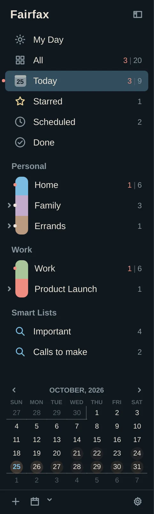

# Getting started

Fairfax is a keyboard-friendly task manager for Linux (and, with a little more
effort, macOS and Windows). It keeps your tasks in a file on your own computer.
It can sync them between machines through a private git repository, a folder, or
a server you choose. Nothing leaves your machine unless you set that up.

This chapter takes you from nothing to your first task.

## Install Fairfax

The quickest way is one line in a terminal:

```sh
curl -fsSL https://github.com/jrimmer/fairfax/releases/latest/download/install.sh | bash
```

It downloads the latest release, checks every file against its published
checksum, and installs it.

- **On Arch Linux (including Omarchy)** it installs the pacman package. It uses
  `sudo` only for the final `pacman -U` step. If you are already root and have no
  `sudo`, it says so and carries on.
- **On any other Linux** it installs an AppImage under `~/.local`. No root needed.
- **On Omarchy** it also runs `fairfax setup omarchy` for you after a fresh
  install (see below). Add `--no-setup` to skip that: `… | bash -s -- --no-setup`.

You are welcome to read the script before you run it. It is short, and it is
published next to the release.

### Other ways to install

The [latest release](https://github.com/jrimmer/fairfax/releases/latest) also
has plain x86_64 packages:

| File | For | Install with |
|---|---|---|
| `fairfax-x86_64.pkg.tar.zst` | Arch | `sudo pacman -U <file>` |
| `fairfax-amd64.deb` | Debian 13, Ubuntu 25.04 and later | `sudo apt install ./<file>` |
| `fairfax-x86_64.rpm` | Fedora 41 and later | `sudo dnf install ./<file>` |
| `fairfax-x86_64.AppImage` | Most Linux from about 2022 on | `chmod +x <file> && ./<file>` |
| `fairfax-linux-x86_64.tar.gz` | Anywhere | Unpack it and run `fairfax-linux-x86_64/bin/fairfax` |

On ARM you will need to build from source unless the release lists ARM files.
macOS and Windows builds are best effort. They work, but they are not packaged as
neatly, and a few Linux-only extras (the Omarchy setup, the Waybar badge) are not
there.

To remove Fairfax, run the installer again with `--uninstall`.

### Try it without risking anything

`fairfax --demo` opens a throwaway copy filled with sample tasks. It never
touches your real tasks, which makes it a good place to practise.

## Set up Omarchy

If you installed with the one-liner on Omarchy, this is already done. Otherwise,
or if you want a different Quick Entry key, run:

```sh
fairfax setup omarchy
```

It adds three things, each in a clearly marked place:

- **A Quick Entry key.** Press **Super+Shift+T** anywhere to jot down a task
  without switching windows. To choose another key, run
  `fairfax setup omarchy --key "SUPER + ALT + T"`. Fairfax refuses a key that is
  already taken. Quick Entry and Settings open floating and centred.
- **Menu entries.** Press **Super+Space** and choose **Fairfax** for *New Task*,
  *Today*, *Find a Task* and *Settings*.
- **Background start.** Fairfax starts quietly when you sign in. That is how
  alarms reach you with the window closed, and how Quick Entry appears
  instantly.

Hyprland's part lives in `~/.config/hypr/fairfax.lua`, loaded by one line in
`hyprland.lua`. The menu entries are a marked block in
`~/.config/omarchy/extensions/omarchy-menu.jsonc`. Both files are backed up
before they change. To undo it, run `fairfax setup omarchy --remove`. It takes out
only what setup still owns: if you have edited `fairfax.lua` or the menu section,
that part is yours and stays (it says what it kept). An edited `fairfax.lua` stays
on disk but is no longer loaded; only setup's own marked line leaves `hyprland.lua`.

If you lay out floating windows in thirds on Hyprland, Fairfax opens into the free
third. You can turn that off in [Settings](12-settings.md).

### On another desktop

There is no setup command, but the pieces are easy to do by hand:

- Bind a key in your desktop's settings to the command `fairfax --quick`. That
  opens Quick Entry.
- Add `fairfax --background` to your autostart so alarms arrive with the window
  closed.
- On macOS use Shortcuts.app or Raycast for the key. On Windows give a shortcut to
  `fairfax.exe --quick` a hotkey in its properties.

## Open Fairfax for the first time

Open it from the launcher (Super+Space, then type "Fairfax"). A new database opens
on **My Day**, a plan for today. With no tasks yet it says *Nothing planned for
today*. That is fine. A new database starts with two lists, *Home* and *Work*, in a
group called *Personal*. Click *Home*, press **Ctrl+N** and type your first task.

Your tasks live in `~/.local/share/fairfax/fairfax.db`. If you ever need to open a
different file, start Fairfax with `--db PATH`.


## The three panels

The window has three panels, left to right.

1. **Lists** (left). Everything you can look at: My Day, an optional Inbox, the
   five focus lists (*All*, *Today*, *Starred*, *Scheduled*, *Done*), your own
   lists grouped under headings, and your Smart Lists. A small calendar sits under
   the lists, and the footer shows when sync last worked.
2. **Tasks** (middle). The tasks in whatever you picked on the left. This is where
   you spend most of your time.
3. **Tags** (right). Your tags, grouped. Click a tag to filter the middle panel to
   it. A second tab holds your places.

You can hide the side panels when you want more room. **Ctrl+Alt+←** shows or
hides Lists, and **Ctrl+Alt+→** shows or hides Tags. Fairfax remembers your
choice.



## Your first five minutes

1. Press **Ctrl+N**, type "Call the dentist tomorrow at 9am", and press
   **Return**. Fairfax picks the date and time out of your words.
2. Press **Ctrl+2** to look at *Today*, or **Ctrl+4** to see *Scheduled*.
3. Select a task with the arrow keys. Press **Space** for a closer look,
   **Return** to edit it, or **Ctrl+.** to complete it.
4. Press **?** at any time to see every shortcut.

Chapter 2 explains each of these properly.

## Moving in from another app

If your tasks live somewhere else today, you don't have to retype them. Fairfax
can bring in TickTick, Things, OmniFocus, iCalendar files, and task databases.
[Moving in](10-moving-in.md) walks through each one, and every import can be
undone.

## Where to go next

- [The basics](02-basics.md) covers adding, editing and finishing tasks.
- [My Day](05-my-day.md) shows how to plan a day in a minute.
- [Sync and backups](08-sync-and-backups.md) is worth reading before you rely on
  Fairfax on more than one computer.
