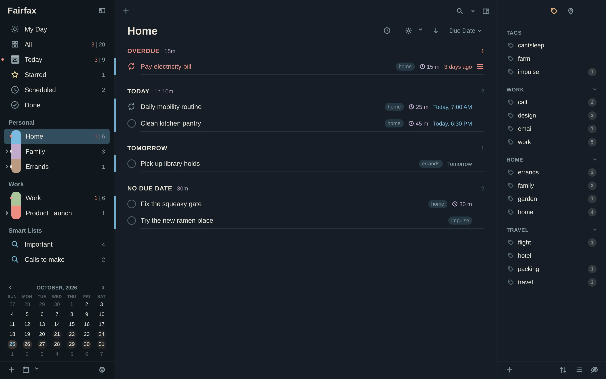
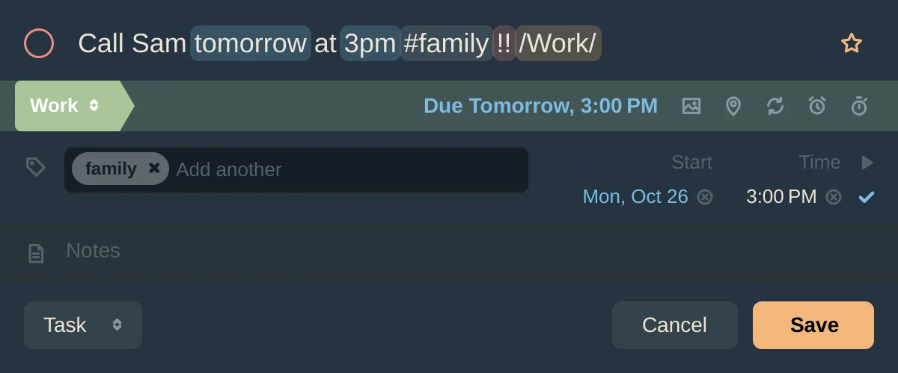
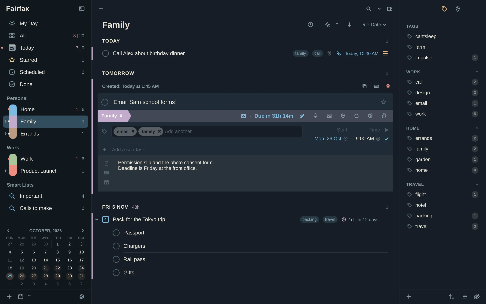
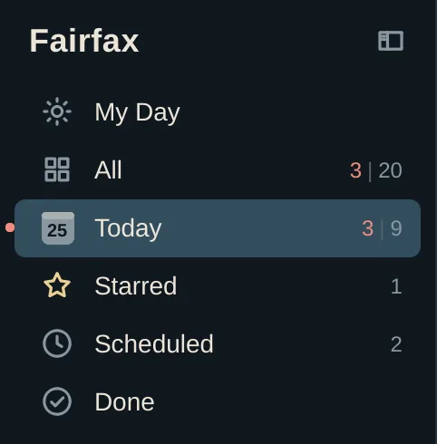
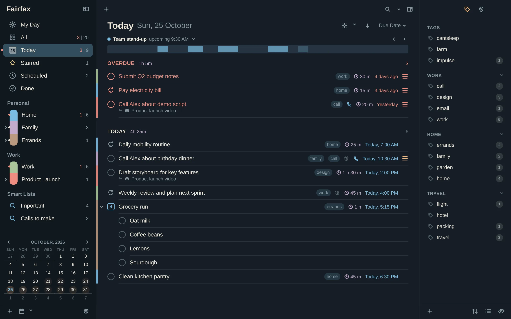
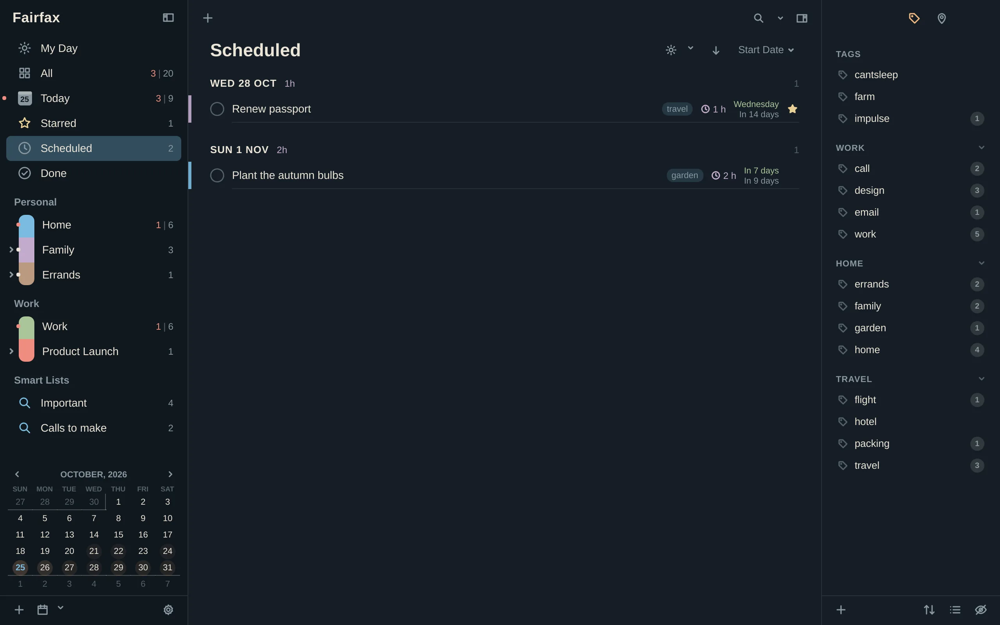
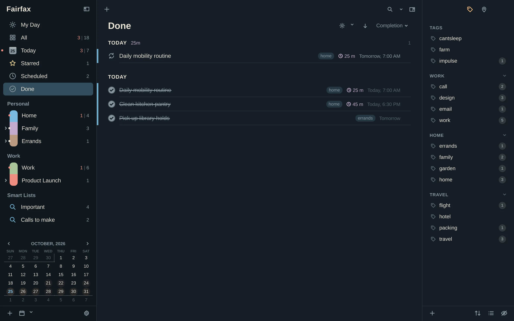

# The basics

This chapter covers what you will do every day: make tasks, say when they matter,
finish them, and look at them through the focus lists.

## Lists and list groups

A **list** is a place for related tasks: *Home*, *Work*, *Errands*. You can keep
as many as you like. A **list group** is a heading that gathers lists in the
sidebar, such as *Personal* and *Work*.

### Make a list

- **Keyboard:** press **Ctrl+Shift+N**.
- **Mouse:** click the **+** in the Lists panel and choose **New List**. The same
  menu has **New List Group**, **New List in Group** and **New Smart List…**.

Type a name and press Return. Right-click a list and choose **Edit List…** to
change its name, colour and group, and to decide whether its tasks show up in
*All*, *Today* and *Done*. You can also drag lists to reorder them and drop them
into a group.



### The Inbox

Settings → Tasks has a **Getting Things Done® Inbox** switch. When it is on, you
get a list called *Inbox* that catches tasks you add without choosing a list.
Pressing **Ctrl+0** jumps to it. Turn it off and the Inbox and its tasks are
deleted. **Ctrl+Z** brings them back.

## Add a task

Fairfax gives you two doors, and they behave the same.

### In the main window

1. Pick the list you want (or *Today*, or *Starred*; see below).
2. Press **Ctrl+N**.
3. Type the title and press **Return**.

The task lands in the list you are looking at. A task added while *Today* is open
is due today, and one added in *Starred* is starred. If you would rather every
task go to one place, set a **Default list** in
[Settings → Tasks](12-settings.md#tasks) and turn on **Always use the default list
for new tasks**.

### With Quick Entry

Quick Entry is a small window for capturing a thought without leaving what you
are doing. Press your Quick Entry key (**Super+Alt+T** on Omarchy), type, and
press **Return**. You can also run `fairfax --quick`.



Quick Entry is one line to type, with a row of labelled pills under it: list,
due, start, repeat, alert, duration, tags, place, priority, star and attach. The
pills always show what the task will get. To change one, click it, or press
**Tab** to reach it. Its choices open in a row underneath. Pick with the mouse,
the arrow keys or a digit, and press **Escape** to close the row.

| Key in Quick Entry | What it does |
|---|---|
| **Return** | Save the task |
| **Shift+Return** | Save, and start another (pressing your Quick Entry key again does the same) |
| **Ctrl+Return** | Save, and open the task in the main window |
| **Ctrl+W** | Hide Quick Entry |

Two clipboard conveniences: if you paste several lines, the first becomes the
title and the rest go into the notes. If you paste a link, it becomes the title and
the task's link action. Quick Entry can also fill the notes from the clipboard when
it opens; that is a switch in [Settings → General](12-settings.md#general).

## Type it the way you would say it

You don't have to fill in fields. Write the task naturally and Fairfax picks out
the details, fills the pills (or the capsules in the main window), and removes
those words from the title:

```
Call Sam tomorrow at 3pm #family !! every Monday [30m] /Work/
```

This makes a task called "Call Sam", due tomorrow at 3 PM, tagged *family*, medium
priority, repeating every Monday, lasting 30 minutes, in the *Work* list.

What it understands:

| You type | You get |
|---|---|
| `tomorrow`, `fri`, `next week`, `in 2w`, `Dec 3` | A due date |
| `at 3pm`, `15:30`, `evening` | A due time |
| `starting Friday`, `starts tomorrow` | A start date (see [below](#start-dates-and-due-dates)) |
| `from Monday until Friday` | A start and a due date |
| `every Monday`, `every 2 weeks`, `every day` | A repeat |
| `alert 30m` | An alert 30 minutes before |
| `[30m]`, `[1h30m]` | A duration |
| `!`, `!!`, `!!!` | Low, medium or high priority |
| `*` | A star |
| `#family` | A tag |
| `/Work/` | A list (it must be a list you already have) |
| `@ Home` | A place (it must be a place you already have) |

Put words in `"quotes"` to keep them exactly as typed. "Call 'tomorrow' bakery" will
not become a date.

The same detection works for a new task's title in the main window. There it
shows what it found as capsules, with a **Stop detecting** chip you can click to
switch it off for that one task. If you never want it, turn it off in
[Settings → Tasks](12-settings.md#tasks). Quick Entry and the editor each have
their own switch.

## Edit a task

- **Keyboard:** select it and press **Return**.
- **Mouse:** double-click it.

The editor opens in place. Press **Esc** or **Ctrl+Return** to finish.



From the editor you can set:

- the **title** and **notes** (notes understand Markdown, clickable links, and
  `@{Task name}` links to other tasks; type `@{` for a picker)
- **due** and **start** dates, with a calendar behind each field
- a **repeat**, **alerts**, a **duration**, a **location**, and an **action**
  (call, message, email, open a link, visit, search the web)
- **tags**, **priority** and a **star**
- attached files, pictures and audio notes
- **sub-tasks**, added with Return (see [Organizing](03-organizing.md))

Dates are typeable. Click a date field and type `tom`, `fri` or `in 2w`, or press
**↓** to open a calendar. Alt+1 to Alt+4 fill in Today, Tomorrow, the day after, and
a week from now.

Many fields have their own jump key, so you rarely need the mouse. Open the
editor straight at a field with:

| Keys | Opens the editor at |
|---|---|
| **Ctrl+E** | Notes |
| **Ctrl+B** | Action |
| **Ctrl+G** | Location |
| **Ctrl+'** | Alerts |
| **Ctrl+/** | Dates |
| **Ctrl+;** | Repeat |

### Quick changes without opening the editor

With a task selected, single keys change it in place:

| Key | Does |
|---|---|
| **t** / **y** | Due today / due tomorrow |
| **d** | Defer: type `tom 3pm`, `fri`, `in 2w`, or an offset like `+3d` |
| **k** | Schedule (start date), the same way |
| **e** / **x** | Set the due time / the duration |
| **]** and **[** | Due date a day later / earlier (hold Shift for a week) |
| **l** | Add tags |
| **m** | Move to another list |

[The keyboard chapter](07-keyboard.md) has the full table.

## Move a task to another list

Press **m**, pick a list, and press Return. Or drag the task onto a list in the
sidebar. You can drop it on *Today*, *Starred* or *Done* too, to change it the
way that list implies.

## Complete a task, and change your mind

- **Keyboard:** select it and press **Ctrl+.**
- **Mouse:** click the circle to the left of the title.

Press **Ctrl+.** again, or **Ctrl+Z**, to bring it back. Everything you do in
Fairfax can be undone with **Ctrl+Z**, and redone with **Ctrl+Shift+Z**.

A completed task moves to *Done*. How long it stays in the list you are in is up
to you: see **Show completed tasks for** in
[Settings → Tasks](12-settings.md#tasks). You can also hide completed tasks
for the moment with **Ctrl+O**. A repeating task is different: completing it
keeps a done copy and moves the task on to its next date. See
[Repeats and alerts](06-repeats-and-alerts.md).

## Abandon a task you will not do

Some tasks you decide not to do. Completing them would be a small lie, and
deleting them throws the record away. **Abandon** closes the task as "won't do":

- **Mouse:** right-click the task and choose **Abandon**. The editor has an Abandon
  button (the ✕ beside the trash can) too.
- **Keyboard:** select it and press **w**, or **Ctrl+Alt+A** from anywhere.

An abandoned task closes the way a completed one does. It leaves your lists under the
same **Show completed tasks for** setting, and it appears in *Done*, but struck
through, dimmed and marked **Abandoned**. It is never counted as done: not in My Day's
*Done today*, and not in any total. Press **w** or **Ctrl+Alt+A** again (or choose
**Mark as Not Abandoned**) to reopen it, or press **Ctrl+Z**, just as for a
completed task. In a project, abandoning the project abandons the tasks still open
inside it; tasks you had already done stay done.

To see only one kind in *Done*, open the search presets (the small arrow beside the
search box) and choose **Abandoned** or **Completed Only**. A repeating task is
different: see [Repeats and alerts](06-repeats-and-alerts.md).

## Start dates and due dates

Fairfax keeps two dates, and the difference is the most useful thing to learn.

- The **due date** is when a task must be done.
- The **start date** is when you want to see it.

A task with a start date in the future stays out of the way. It waits in
*Scheduled* and appears on the day it starts. That keeps today's list honest:
"Plant the autumn bulbs" does not nag you in July.

Once the start date has passed, the task stays visible until it is done, even if
it has no due date. Fairfax calls this "still working on".

Quick ways to set them: **t** and **y** set the due date, **Ctrl+T** starts a task
today, **.** and **,** nudge the start date.

## Durations

A **duration** says how long a task will take: `[30m]` when you type it, or
press **x** on a task. Durations do three things for you:

- A task with a duration *and* a due time shows up ahead of its deadline, because
  Fairfax counts back from the due time.
- Headings show the total time still to do (for example "2h 45m"). That can be
  turned off in [Settings → Appearance](12-settings.md#appearance).
- [My Day](05-my-day.md) adds them up to tell you whether the day fits.

## Notes

Every task has a notes area. Write whatever helps: a phone number, a checklist of
thoughts, a link. Notes understand Markdown as you type, links are clickable, and
`@{Task name}` makes a link to another task. You can show the first lines of notes
under each task with **Show notes under tasks** in
[Settings → Appearance](12-settings.md#appearance).

## Stars and priority

- A **star** marks a task you care about. Click the star at the end of a row, or
  press **s**. Starred tasks all collect in *Starred*.
- **Priority** has four levels: none, low, medium and high. Press **0**, **1**, **2**
  or **3**, or **=** and **-** to raise and lower it. Right-click the star (or hold
  it) for a priority menu.

Priority and stars affect sorting and show up in My Day's suggestions.

## The focus lists

Five lists near the top of the sidebar gather tasks from every list at once.
They are called *focus lists* because each answers one question.



| List | Shortcut | What you will find |
|---|---|---|
| **All** | Ctrl+1 | Every open task |
| **Today** | Ctrl+2 | What is due today, what is overdue, and what you have started |
| **Starred** | Ctrl+3 | Every starred task |
| **Scheduled** | Ctrl+4 | Tasks hidden until their start date |
| **Done** | Ctrl+5 | Tasks you have completed, and the ones you abandoned |

Tasks that wait in *Scheduled* come back by themselves on their start day. A
task you add while *Today* is open is due today. A task you add in *Starred* is
starred. Today's rules can be changed in
[Settings → Today & Lists](12-settings.md#today--lists): for instance whether
overdue and starred tasks are included.







### Narrow any list with the Focus Filter

The sun icon in the sort bar (or **Ctrl+J**) filters the list you are in to
tasks that are overdue, due today, due this week, high priority, starred, and so
on. Each list remembers its own filter, so you can have *Work* show only what
matters while *Home* shows everything.

### Sorting

Use the sort button in the bar above the tasks to sort by due date, start date,
priority, title, duration and more, and the arrow beside it to reverse. Each list
remembers how you sorted it.

## Look closer without opening anything

Select a task and press **Space** for Quick Look, a floating preview with the
notes, dates and links. Use the arrow keys to move through other tasks while it
stays open. Press **Space** or **Esc** to close it. You can turn Quick Look off in
[Settings → Tasks](12-settings.md#tasks).
