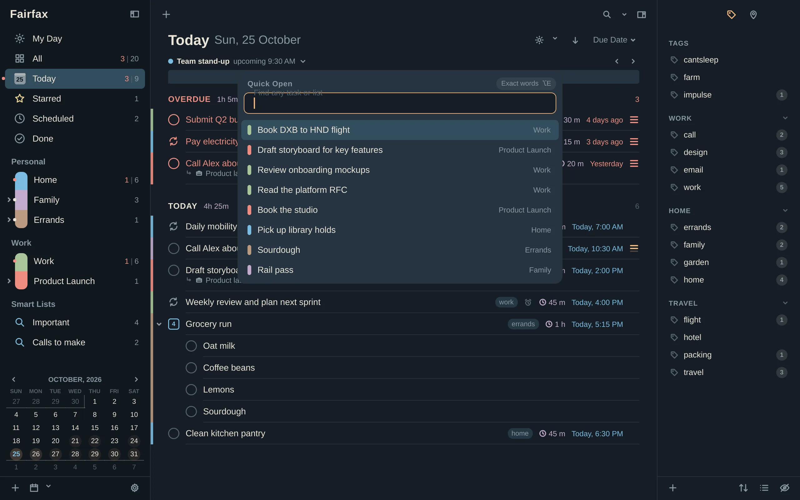
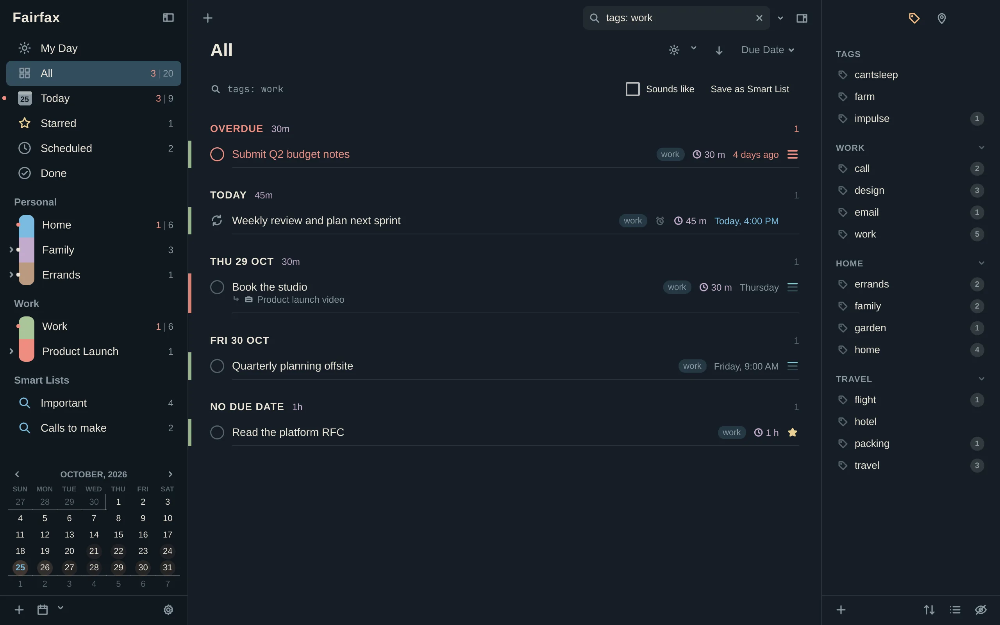
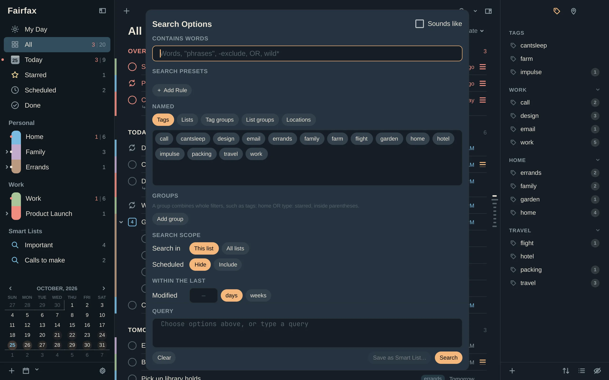
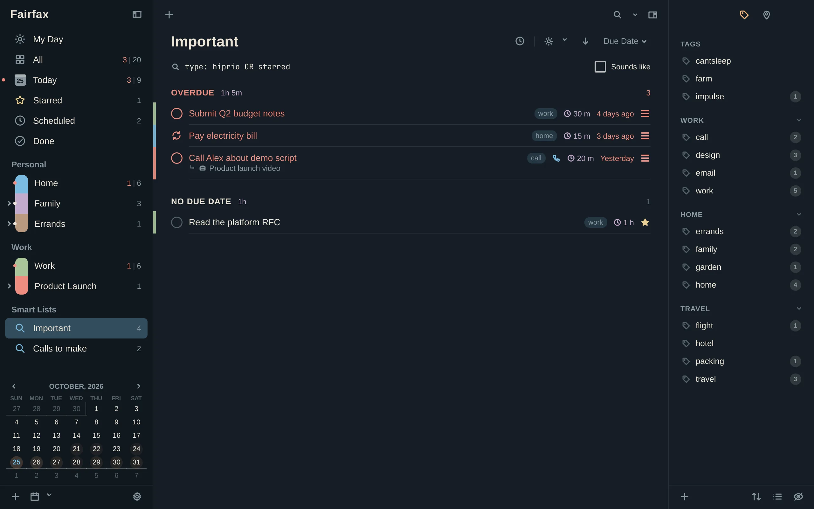

# Search and Smart Lists

When the list you want is "everything tagged *call* that is due this week", you
don't make it by hand. You search for it, and if you will want it again, you save
the search as a **Smart List**.

## Find something quickly

Fairfax has a few finders, each for a different job.

| Keys | Opens | Use it to |
|---|---|---|
| **Ctrl+F** | The search box above the tasks | Filter the list you are in as you type |
| **f** | Find a task | Jump straight to one task, anywhere |
| **j** | Jump to a list | Go to a list by name |
| **/** | Find a tag | Go to a tag by name |
| **Ctrl+Shift+O** | Quick Open | Find any task or list from one box |

Quick Open is also available from outside the window with `fairfax --open`, and
**Find a Task** is in the Omarchy menu.

In any of these bars, **↑** and **↓** move through the matches and wrap at the
ends. The **✕** in the search field clears the search, like **Esc**. There is an
**Exact words** switch (**Alt+E**) that matches whole words only, remembered per bar.

### Search this list or every list

By default the search box looks only in the list you are viewing. Press
**Ctrl+Alt+F** to switch between *this list* and *all lists*. A search that names a
list or a group (see below) always looks everywhere.

### Ready-made searches

The small arrow beside the search box opens **Search Presets**: Overdue, Due Today,
Due This Week, In Progress, High Priority, Starred, Without Due Date, Repeating,
With Alerts, Empty Projects and Checklists, Recently Completed, Completed Only and
Abandoned. Pick one and
the search box fills in the matching search for you. That is also a gentle way to
learn the syntax.

## The search syntax

You can type plain words, or use a few small tricks to be exact. Fairfax never
refuses a search. If part of it makes no sense, that part is treated as ordinary
text, and a hint tells you what it ignored.

Words search a task's title, its notes and its tags.

### Cheat sheet

| Type this | It finds |
|---|---|
| `dentist` | Tasks containing "dentist" |
| `dentist bill` | Tasks containing both words |
| `"exact phrase"` | The words together, in order |
| `dentist OR doctor` | Either word |
| `-bill` or `!bill` | Tasks *without* "bill" |
| `den*` and `*ist` | Words starting or ending that way |
| `type: starred` | Starred tasks |
| `type: hiprio` | High priority (also `medprio`, `lowprio`, `prio`, `noprio`) |
| `type: overdue` | Overdue tasks |
| `type: duetoday`, `duetomorrow`, `duethisweek` | By due date (`type: today` works too) |
| `type: starttoday`, `startthisweek` | By start date |
| `type: anythisweek` | Starts or is due this week |
| `type: nodue`, `type: nostart` | No due date, no start date |
| `type: project`, `checklist`, `subtasks` | By kind of task |
| `type: repeat` | Repeating tasks |
| `type: call` | Tasks whose action is Call (also `email`, `message`, `url`, `visit`, `google`, `action`) |
| `type: alarms` | Tasks with an alert |
| `type: note` | Tasks that have notes |
| `type: duration` | Tasks with a duration |
| `type: inprogress` | Started and not yet done |
| `type: scheduled` | Tasks hidden until their start date |
| `type: paused` | Tasks hidden by a paused tag or place |
| `type: donetoday` | Finished today (also `doneyesterday`, `donethisweek`) |
| `type: completed` | Tasks you finished, not the abandoned ones |
| `type: abandoned` | Tasks you abandoned ("won't do") |
| `type: capturedmail` | Tasks that arrived from [mail](09-mail.md) |
| `tags: home` | Tasks tagged "home" |
| `tags: home, garden` | Tagged either (a comma means "or") |
| `tags: !work` | Tasks not tagged "work" |
| `taggroups: Travel` | Tasks with any tag in the Travel group |
| `lists: Work` | Tasks in the Work list, from every list |
| `groups: Personal` | Tasks in lists in the Personal group |
| `locations: Office` | Tasks at that place |
| `modified: 3d` | Changed in the last 3 days |
| `created: 2w` | Created in the last 2 weeks |
| `completed: 7d` | Completed in the last 7 days (abandoned tasks do not count) |
| `created: >2w` | Created *more than* 2 weeks ago |

A few notes:

- Put a space between filters to mean "and": `type: hiprio tags: !work` is
  "high priority and not tagged work".
- `OR` works between filters too: `type: hiprio OR starred`.
- Use parentheses to group whole filters: `tags: home OR (lists: Work type: starred)`.
- Time units are `min`, `h`, `d` (the default), `w`, `m` (months) and `y`.
- `lists:`, `groups:` and `completed:` always search every list, and `completed:`
  or `type: donetoday` find finished tasks, as do `type: completed` and
  `type: abandoned`. In *Done*, those two narrow the list to one kind.
- Scheduled and paused tasks are hidden from normal views. `type: scheduled` and
  `type: paused` find them anyway.

## Build a search with the rule builder

If you would rather click than type, open **Search Options**. Press
**Ctrl+Shift+Alt+F**, or use the menu beside the search box. The builder writes the
search for you and shows it live at the bottom, where you can also edit it by hand.

The builder has sections, top to bottom:

- **Contains words.** Plain words, "phrases", `-exclude`, `OR` and wildcards.
- **Search presets.** A row per rule, such as *Priority is High*, *Tag is not set* or
  *Status is Abandoned*.
  Choose **Match All** or **Match Any** at the top. Use **[−]** to remove a row and
  **[+]** to add one. **Alt+click** the **[+]** (or right-click it) to add a
  *sub-filter*, a group of rules inside the rules.
- **Named.** Tabs for **Tags**, **Lists**, **Tag groups**, **List groups** and
  **Locations**. Each name is a chip you click to cycle through *off*, *include*
  and *exclude*.
- **Groups.** Combine whole filters, such as `tags: home OR type: starred`, and say
  whether each group is joined by *and*, *or* or *not*.
- **Search scope.** **This list** or **All lists**, and whether to include
  *Scheduled* tasks.
- **Within the last.** Modified, Created and Completed, each as a number and a unit.
- **Sounds like.** A switch near the top that also matches words that sound alike.
  It is remembered.

When you open the builder with a search already typed, it reads back what it
recognises and keeps the rest as text.

## Save a search as a Smart List

A **Smart List** is a saved search that appears in your sidebar and updates itself
as tasks change. Two lists in the demo data show the idea: *Important*
(`type: hiprio OR starred`) and *Calls to make* (`type: call`).

To make one:

1. Type a search, or build one with Search Options.
2. Click **Save as Smart List** (it appears next to a typed search), or
   use **+ → New Smart List…** in the sidebar.
3. Give it a name.

To change one later, right-click it and choose **Edit Search…**, or edit the
saved search shown above the tasks. You can drag Smart Lists to reorder them and
give them colours like any list. Deleting a Smart List deletes only the search, never
the tasks.

### Add a date range

When you save a Smart List from Search Options, a **Smart List options** area adds
what a plain search cannot:

- **Due date.** Choose *between two dates*, *in the next N days, weeks, months or
  years* (a window that moves with today), or *no due date*.
- **Completed.** Follow the usual setting, or always include or exclude finished
  tasks.
- **Include scheduled.** Whether tasks that are waiting for a start date count.

For example, "high priority, due in the next 2 weeks" is a Smart List with
`type: hiprio` and a range of *next 2 weeks*. A Smart List with a range moves
forward every day without you touching it.

## When a search finds a project

If you open a project from a Smart List or a search, you normally see all of its
tasks. Turn on **Inherit search in project view** in
[Settings → Today & Lists](12-settings.md#today--lists) to see only the tasks that
match the search instead.

## From the terminal

The same syntax works in the terminal: `frfx find dentist type: hiprio`. See
[Scripts and agents](11-scripts-and-agents.md).
