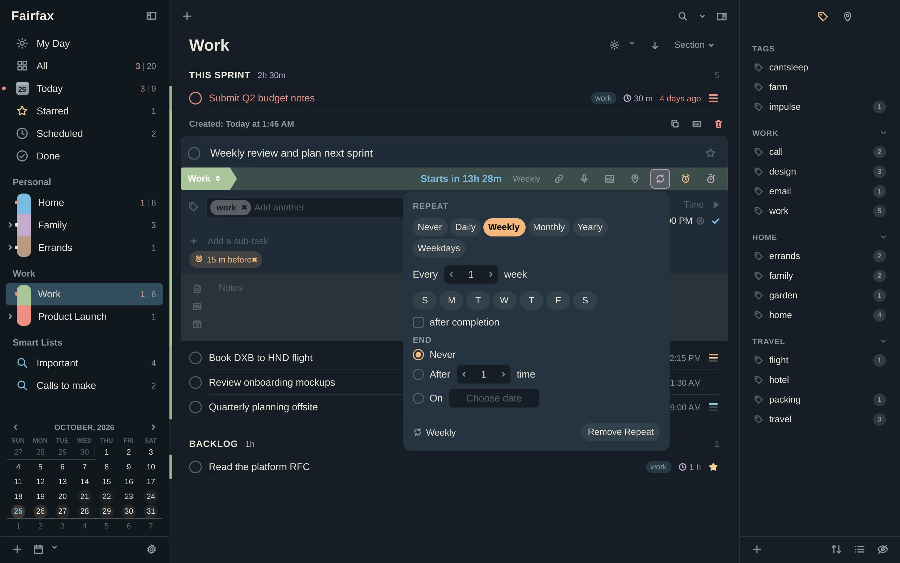
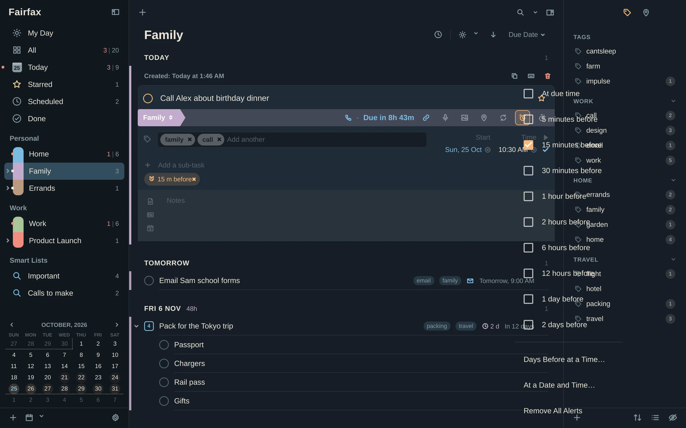

# Repeats and alerts

Some tasks come back every week. Some need a tap on the shoulder before they are
due. This chapter covers both.

## Repeating tasks

A repeating task is one you do again and again: pay the electricity bill, water
the plants, hold the weekly review. You set it up once and Fairfax keeps it going.

### Make a task repeat

Pick whichever way suits you:

- **Type it.** In Quick Entry or a new task's title, add `every Monday`,
  `every 2 weeks` or `every day`.
- **Use the editor.** Open the task and click the repeat button, or press
  **Ctrl+;**.

The repeat editor offers presets (*Daily*, *Weekly*, *Every 2 weeks*, *Monthly*,
*Quarterly*, *Yearly*) and a full custom rule:

- **Every N** days, weeks, months or years.
- **Weekly:** choose which weekdays.
- **Monthly:** on a day of the month ("On day 15"), or on a pattern such as "the
  2nd Tuesday" or "the last Friday".
- **After completion**, explained below.
- **End:** *Never*, *After N times*, or *On* a date you choose.

A line at the bottom of the popup describes the rule in words, so you can check it
says what you mean. A repeating task shows a repeat arrow in place of the usual
circle.

### What happens when you finish one

When you complete a repeating task, Fairfax keeps a done copy in *Done* and moves
the task on to its next date. You never have to re-create it. If the repeat has an
end (after N times, or on a date), the last occurrence simply completes.

You can also **abandon** a repeating task (right-click → **Abandon**, **w** or
**Ctrl+Alt+A**). That skips this occurrence: the task moves on to its next date and
an abandoned copy waits in *Done*. A skipped occurrence is not a finished one, so it
does not count toward "end after N times".

### From the due date, or from when you finished

By default, the next date counts from the *due date*. A bill due on the 1st stays
due on the 1st of every month, even if you pay it on the 5th.

Tick **After completion** and the next date counts from the day you *finished* the
task. That suits things that need a gap rather than a calendar slot: "Water the
ferns, three days after I last did". Set it to every 3 days, after completion.
Finish it on a Thursday and the next one is due on Sunday.

### Seeing and finding repeats

`type: repeat` finds every repeating task (see [Search](04-search-and-smart-lists.md)).
Press **Ctrl+;** on a selected task to look at or change its rule.

## Alerts

An **alert** (Fairfax also says *alarm*) pops up a notification at a time you
choose. A task can have up to ten.

### Add an alert

- **Type it.** Add `alert 30m` to a task's title in Quick Entry. That is an alert
  30 minutes before.
- **Use the editor.** Click the alert button, or press **Ctrl+'**, and pick one:

| Choice | Meaning |
|---|---|
| **At due time**, **5 minutes before**, **15 minutes before**, **30 minutes before** | Counted from the due time |
| **1 hour**, **2 hours**, **6 hours**, **12 hours**, **1 day**, **2 days before** | Counted from the due time |
| **Days Before at a Time…** | A number of days before the due date, at a clock time, for example "1 day before at 6 PM" |
| **At a Date and Time…** | One exact moment |
| **Remove All Alerts** | Clears them |

Each alert is either a **Message** (shown once) or a **Message with Sound** (plays a
sound, and can repeat; see *Nagging* below). Click an alert's chip in the editor to
change which it is.

An alert needs something to count from. If a task has no due date, alerts count from
its **start date**. Choosing a "before due" alert on a task with no dates at all
gives the task today as its due date.

Checklist items cannot have alerts of their own. Put the alert on the checklist.

### Alerts for tasks that only have a date

A task with a due date but no time has no clock time to count from, so Fairfax uses
a time of its own. That is the **Alerts on date-only tasks fire at** setting in
[Settings → Alerts](12-settings.md#alerts) (9:00 AM unless you change it).

### Alerts that add themselves

If you always want a reminder, set **Default Reminders** in
[Settings → Alerts](12-settings.md#alerts): one for tasks with a due time (for
example *15 minutes before*), and one for tasks with only a date (*On the day*, at a
time you choose). Fairfax adds them whenever a task gets a due date and has no
alerts yet. You can still edit or remove them on any task.

### Silence a list

Right-click a list and choose **Mute Alerts**. No task in that list will alert. Unmute
it and alerts that were waiting go off, as long as they are not very old.

## Desktop notifications

When an alert goes off, Fairfax shows a desktop notification with:

- the task's title, its list, its due time, and the first lines of its notes
- a **Complete** button
- a **Snooze** menu
- a button for the task's action, if it has one (*Call*, *Email*, *Open Link*…)
- clicking the notification opens the task in Fairfax

While you have Do Not Disturb on in mako or dunst, notifications stay silent. A
notification closes by itself if you complete the task, delete it, or change its
date.

### Snooze

Not now? Snooze offers:

- **Snooze 5 Minutes**
- **Snooze 15 Minutes**
- **Snooze 1 Hour**
- **This Evening** (7:00 PM, or tomorrow's if that has passed)
- **Tomorrow Morning** (at your **Default due time** if you have set one, otherwise
  9:00 AM)

The two date-based choices show the time they land on.

### Nagging

For an alert that you really cannot miss, **Settings → Alerts → Sound alerts repeat
until dismissed** makes it repeat every 2, 5 or 10 minutes until you complete or
snooze the task. The default is *Never*. Only alerts set to **Message with Sound**
repeat. A plain **Message** is shown once.

### With the window closed

Alerts are delivered by the Fairfax program, not by the window. Closing the window
does not stop them, as long as Fairfax keeps running in the background. That is the
default (**Keep running in the background when the window closes**, in
[Settings → General](12-settings.md#general)), and Omarchy's setup starts Fairfax at
sign-in for exactly this reason. Press **q** or **Ctrl+Q** to quit for real. After that,
no alerts arrive.

- Alerts that came due while Fairfax was not running go off when it starts, unless
  they are more than a day old. Those are quietly marked as done with.
- On Linux, a small badge in the tray (or in a Waybar module) shows how many tasks
  are overdue or due today. Choose what it counts in
  [Settings → Alerts](12-settings.md#alerts), under **Badge shows**.
- If you use the Waybar module, it turns red with a **!** when alerts are waiting and
  Fairfax is not running to deliver them. See
  [Scripts and agents](11-scripts-and-agents.md).

On macOS and Windows, alerts appear as tray messages.
