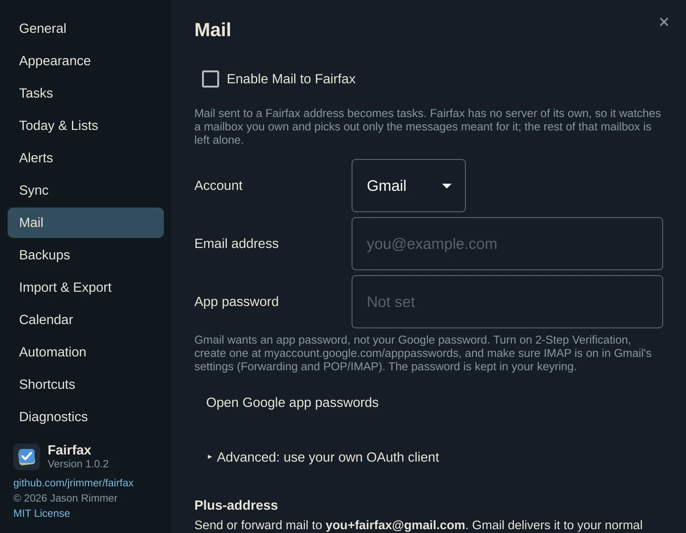

# Mail to tasks

Some tasks arrive as email: a bill, a message from a teammate, a note you send to
yourself from your phone. Fairfax can turn those messages into tasks for you.

Fairfax has no server of its own, so it cannot host an address you email directly.
Instead it watches **a mailbox you already own** and picks out only the messages meant
for it. The rest of that mailbox is never fetched, flagged or moved. The mailbox can
be your everyday one.

Mail is off until you turn it on in **Settings → Mail**.



## How a message becomes a task

- The **subject** becomes the title. Leading `Re:`, `Fwd:`, `AW:` and friends are
  trimmed.
- The **plain-text body** becomes the notes, up to 10,000 characters. Attachments and
  HTML formatting are dropped. A message with only HTML is turned into text.
- If the body has lines numbered `1.` `2.` `3.`, they become a **checklist**.
- A signature ends the body: `-- `, "Sent from my iPhone", "Get Outlook for …".
- A message becomes **one task, once**. Fairfax remembers each message, so fetching it
  again, or fetching it on two computers that sync, never makes a second task, even if
  you deleted the first.

To find everything that arrived this way, search for `type: capturedmail`.

## Filing instructions in the subject

You can tell Fairfax where a task goes and when it matters by adding instructions to
the subject. They are taken out of the title.

| Instruction | Does |
|---|---|
| `start(tomorrow)` | Sets the start date |
| `due(friday 3pm)` | Sets the due date and time |
| `priority(!!!)` | Sets the priority (`!`, `!!` or `!!!`) |
| `list(Work)` | Files it in the Work list |
| `tag(home, diy)` | Adds tags |
| `action(call, 0793273373)` | Sets an action: `call`, `message`, `url`, `visit`, `google` or `email` |

For example, the subject `Fix the gate due(saturday) tag(home) priority(!!)` becomes a task
called "Fix the gate", due Saturday, tagged *home*, medium priority.

If a list does not exist, the task goes to your destination list instead. An
instruction Fairfax does not recognise stays in the title.

If you would like to type dates and tags the way you do in Quick Entry
(`Call Sam tomorrow 3pm #home !!`), turn on **Read dates and tags in the subject**.

## Gmail

Gmail is the default. You need an **app password**, not your Google password.

1. Turn on **2-Step Verification** for your Google account.
2. Make an app password at
   [myaccount.google.com/apppasswords](https://myaccount.google.com/apppasswords). The
   pane has an **Open Google app passwords** button.
3. Check that **IMAP** is on in Gmail's settings (*Forwarding and POP/IMAP*).
4. In Settings → Mail, choose **Gmail**, enter your address, paste the app password
   (it is stored in your keyring, never in the database), and turn on **Enable Mail
   to Fairfax**.

### The plus-address filter

You pick out the mail meant for Fairfax with a *plus-address*. Gmail delivers mail sent
to `you+fairfax@gmail.com` to your normal inbox, as if it were `you@gmail.com`. Fairfax
takes only the mail sent to that address, files it under a **Fairfax** label and out of
your inbox, and leaves everything else alone.

So: send or forward a message to `you+fairfax@gmail.com`, and a task appears. The pane
shows your exact address, with a **Copy address** button. Save it as a contact on your
phone and "email it to myself" becomes a one-tap capture.

### Your own Google sign-in (advanced)

An app password is the easy route. If you prefer Google sign-in, Fairfax ships no
Google client of its own. You create one in your own Google Cloud project:

1. Create an OAuth client of type **Desktop app**.
2. Publish its consent screen to **Production**, or Google ends the sign-in after
   seven days.
3. Download its `client_secret.json`.
4. In Settings → Mail, open **Advanced: use your own OAuth client**, choose **Import
   client JSON…**, then **Sign in with Google**.

## Outlook.com and Microsoft 365

Outlook has no sign-in that needs no setup, so the pane offers options that need none
first:

1. **Forward it.** Add an Outlook rule that redirects the mail you choose to your Gmail
   plus-address, or to any other mailbox you connect here.
2. **Use DavMail.** [DavMail](https://davmail.sourceforge.net/) (in the AUR) is a small
   program on your computer that makes Outlook look like an ordinary IMAP server.
   Set it up, then click **Use DavMail** in Fairfax. It fills in `127.0.0.1`, port 1143
   and no encryption.
3. **Your own client ID.** Advanced. Register an app in Microsoft Entra (App
   registrations) as a public client with the redirect `http://localhost` and the
   delegated `IMAP.AccessAsUser.All` permission. Paste its Application (client) ID
   under **Use your own client ID**, then click **Sign in with Microsoft**. Work and
   school accounts may need an administrator to allow it.

## Any other IMAP server

For Fastmail, Dovecot, ProtonMail Bridge and the like, choose **Other**. Fill in the
**Server**, **Port**, **Security** (*TLS*, *STARTTLS* or *None*), your **User name** and
**Password**. *None* is only for a bridge on your own computer (`127.0.0.1`).

## Choose which mail, and what happens next

Under **Which mail**:

- **Only mail sent to** takes messages addressed to that address (To, Cc,
  Delivered-To or X-Original-To). For Gmail it starts as your plus-address.
- **Only mail labelled** takes messages with a Gmail label (or an IMAP keyword on
  other servers).
- **Folder** is where to look (`INBOX` by default).

If both filters are empty, **every message in the folder becomes a task**, and the pane
warns you in red. Be careful.

Under **What happens**:

- **After importing:** *Move to* a folder or label (made for you if missing; Gmail's
  default is *Fairfax*), *Mark as read*, or *Leave as is*. Messages that already became
  tasks get the same treatment. *Leave as is* is safe: Fairfax remembers what it has
  already read.
- **New tasks go to:** a list (the Inbox by default).
- **Check every:** how often to look, in minutes. This only matters when the server
  cannot tell Fairfax about new mail. Most can, and then new mail arrives at once.

The **Status** area has **Fetch Now** and a line saying how it went. **Ctrl+S** and the
sidebar's sync button also fetch mail. Messages over 25 MB are skipped, and Fairfax
says so.

While Fairfax is running, it watches the mailbox in the background, so your tasks arrive
even with the window closed.

## From a script: `fairfax import-mail`

You do not have to let Fairfax read a mailbox. If you already use Sieve, procmail,
fetchmail or ProtonMail Bridge, hand messages to Fairfax yourself:

```sh
fairfax import-mail message.eml              # or several files
some-fetcher | fairfax import-mail --list Work
fairfax import-mail --maildir ~/Mail/fairfax  # everything in new/, moved to cur/ as seen
fairfax import-mail --natural-language ...    # also read "tomorrow 3pm #home !!" in the subject
```

It prints a line for each message (`Added "Title" to List` or `Skipped: duplicate`).
It exits with 0 when everything was added or was a duplicate, 1 for a message it could
not read, and 2 for bad usage. It works while the app is open, and the new tasks appear
within a couple of seconds.

You can also **drag a mail message** (an `.eml` file) onto a task, or onto empty space in
the task list. Dropped on a task, it becomes that task's action (or goes in its notes, if
it already has an action). Dropped on empty space, it makes a new task titled with the
subject.
