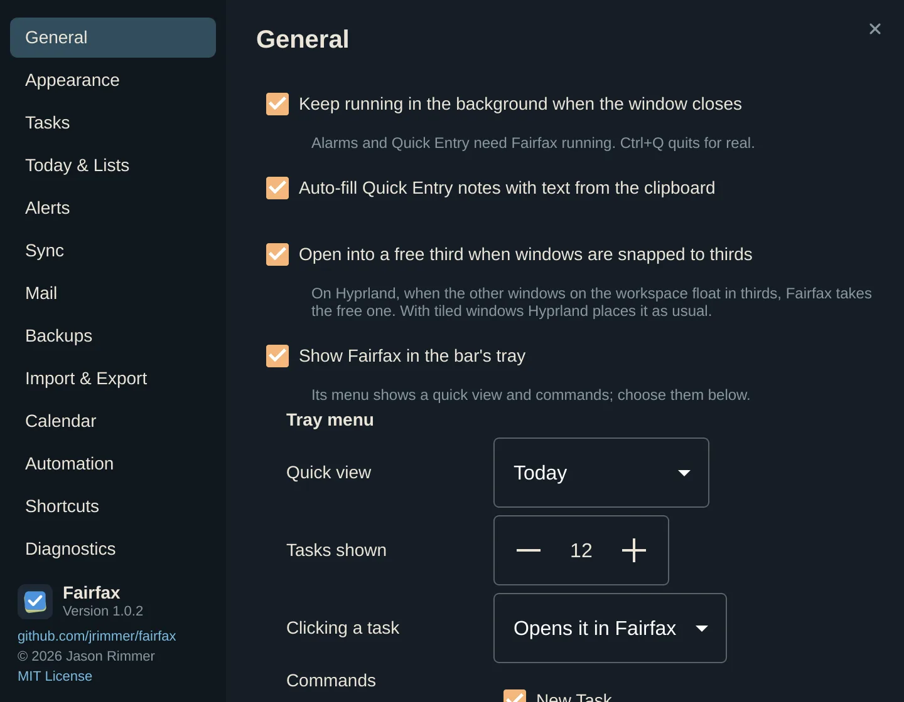
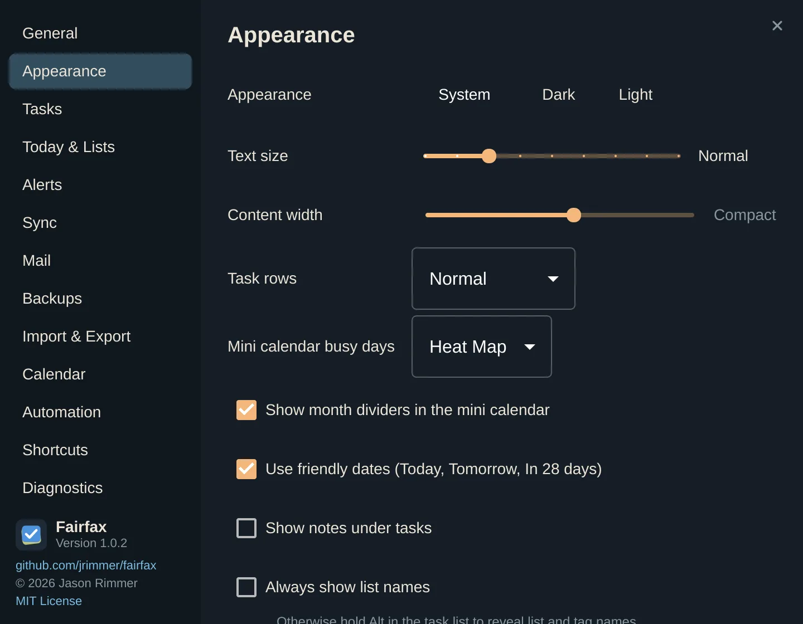
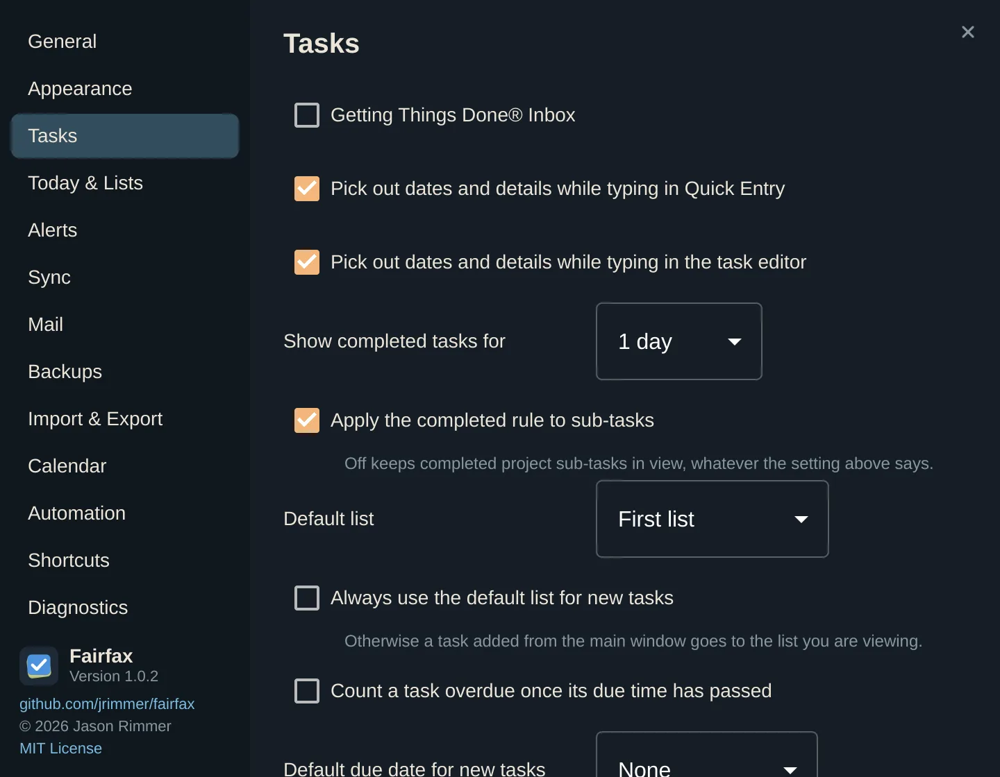
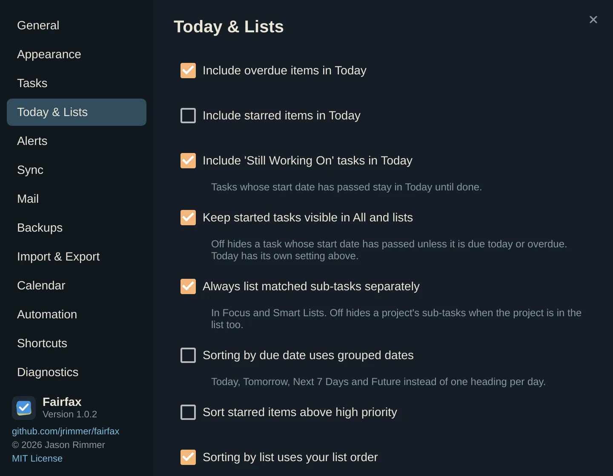
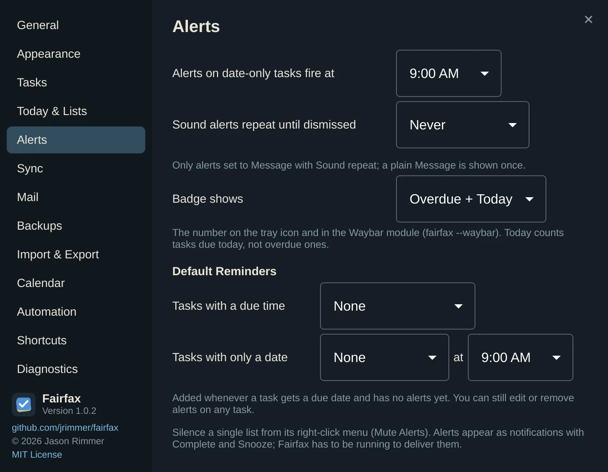
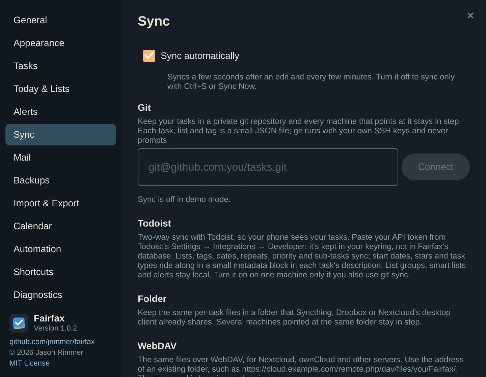
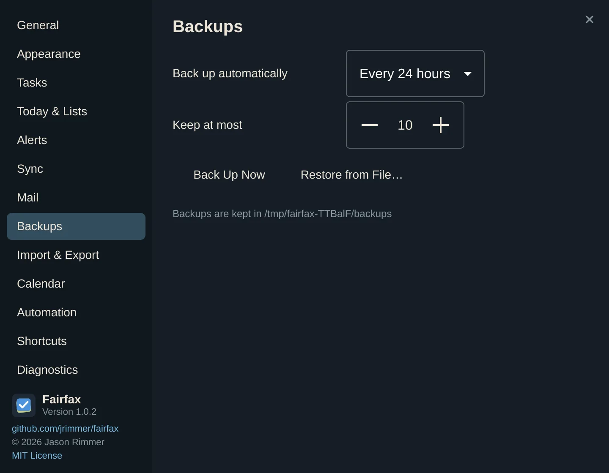
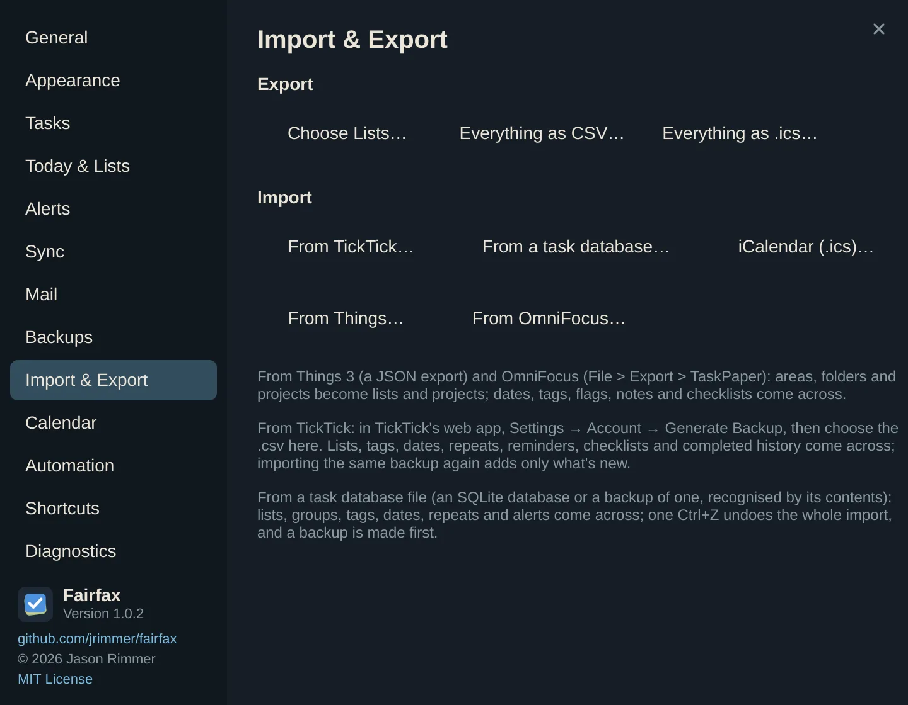
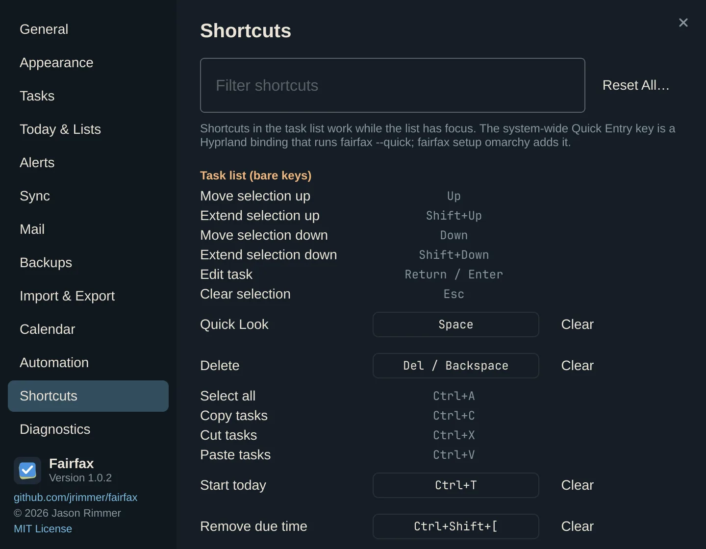

# Settings

Open Settings with **Ctrl+,**, from the tray menu, from the Omarchy menu (**Super+Space →
Fairfax → Settings**), or by running `fairfax --settings`. Choose a pane on the left.
Everything applies at once; there is no Save button. Close the window with **Esc**,
**Ctrl+W** or the ✕ in the corner. Each pane opens scrolled to its top.

The panes are described below in the order the window shows them. Each setting says what
it does, its default, and when you might change it. Where a setting only exists on some
systems, that is noted.

At the bottom left of the window is a note on the version, the project page and the
licence (MIT).

## General

| Setting | Default | What it does and when to change it |
|---|---|---|
| **Keep running in the background when the window closes** | On | Closing the window leaves Fairfax running so alarms arrive and Quick Entry is instant. **q** or **Ctrl+Q** quits for real. Turn it off if you never use alerts and want closing to mean closing. |
| **Auto-fill Quick Entry notes with text from the clipboard** | On | When Quick Entry opens, whatever you last copied is offered as notes. Turn it off if you would rather start blank. |
| **Open into a free third when windows are snapped to thirds** | On | Linux only. On Hyprland, when the other windows on the workspace float in thirds, Fairfax takes the free one. With tiled windows Hyprland places it as usual. |
| **Show Fairfax in the bar's tray** | On | A tray icon with a quick view of today. The settings below it only apply while this is on. |

**Tray menu** (while the tray icon is on):

| Setting | Default | What it does |
|---|---|---|
| **Quick view** | Today | Which list the tray menu previews: Today or another list. |
| **Tasks shown** | 12 | How many tasks the quick view lists, from 3 to 30. |
| **Clicking a task** | Opens it in Fairfax | Or **Completes it**, handy if you tick tasks off from the tray. |
| **Commands** | All five | Tick which commands the menu keeps: **New Task**, **Open Fairfax**, **Find a Task**, **Sync Now**, **Settings**. |
| **Badge colour** | Red | The colour of the number on the tray icon. **Reset** goes back to red. The number itself is chosen under Alerts → *Badge shows*. |

Then:

| Setting | Default | What it does and when to change it |
|---|---|---|
| **Default view** | My Day | What Fairfax opens on: *My Day* (only while it is on), *Last viewed*, *Today*, *All*, *Starred*, *Scheduled*, *Inbox* (when on), or any list or Smart List by name. Pick *Last viewed* if you like to continue where you stopped. If the chosen list is deleted, Fairfax falls back to Today. |
| **Week starts on** | Automatic (your system's choice) | *Monday*, *Sunday* or *Saturday* instead. Used by this-week searches and the Focus Filter, the mini calendar, date pickers and weekly repeats. Fairfax is English only; month and day names are English, and dates are laid out for your system's locale. |
| **Play task completion sounds** | On | A small sound when you complete a task. |
| **Celebrate when a list is cleared** | On | A little confetti when the last task in a list is finished. |

On Linux the pane ends with a reminder of `fairfax setup omarchy`.

## Appearance

| Setting | Default | What it does and when to change it |
|---|---|---|
| **Appearance** | System | *System* follows the Omarchy theme live, light or dark, and changes with it. *Dark* and *Light* force one. |
| **Text size** | The standard size | A slider from smallest to largest. **Ctrl+=** and **Ctrl+-** do the same from anywhere. A good first step for readability. |
| **Content width** | 980 | How wide the task area gets in a big window. Slide towards *Compact* for narrower, easier-to-scan rows. |
| **Task rows** | Normal | *Compressed* fits more tasks, *Extended* gives each more room. |
| **Mini calendar busy days** | Heat Map | How busy days show on the small calendar: *Heat Map*, *Dots* or *None*. |
| **Show month dividers in the mini calendar** | On | A thin line between months. |
| **Use friendly dates (Today, Tomorrow, In 28 days)** | On | Off shows plain dates instead. |
| **Show notes under tasks** | Off | Shows the start of each task's notes beneath its title. |
| **Always show list names** | Off | Otherwise hold **Alt** in the task list to reveal list and tag names. |
| **Always show tag names** | On | Off shows a tag icon instead (hold **Alt** to see the names). Narrow windows always show the icon. |
| **Show overdue tasks in red** | On | Overdue dates and circles turn red. |
| **Show durations in headings** | On | Shows the time still to do under each heading, such as 2h 45m. |

## Tasks

| Setting | Default | What it does and when to change it |
|---|---|---|
| **Getting Things Done® Inbox** | Off | Adds an *Inbox* list for tasks you add without choosing a list. Turning it off deletes the Inbox and its tasks (Ctrl+Z restores them), and asks first. |
| **Pick out dates and details while typing in Quick Entry** | On | The plain-language reading described in [The basics](02-basics.md). |
| **Pick out dates and details while typing in the task editor** | On | The same, for the editor and new tasks in the main window. |
| **Show completed tasks for** | 1 day | How long a finished task stays in the lists. See the note below. |
| **Apply the completed rule to sub-tasks** | On | Off keeps completed project sub-tasks in view whatever the setting above says. |
| **Default list** | First list | Where new tasks go when you do not choose: *First list*, *Last used*, or a list by name. Unavailable while the Inbox is on, since new tasks go there. |
| **Always use the default list for new tasks** | Off | Otherwise a task added from the main window goes to the list you are viewing. |
| **Count a task overdue once its due time has passed** | Off | By default a task is overdue only after its due *day*. Turn this on if a 3 PM deadline should turn red at 3:01 PM. |
| **Default due date for new tasks** | None | Gives each new task a due date: *Same Day*, *Day After*, *2 Days Later*, *3 Days Later*, *1 Week Later*, *2 Weeks Later* or *Next Month*. |
| **Only use the default due date in Quick Entry** | Off | Needs a default due date. The main window then leaves new tasks undated. |
| **Do not use the default due date in Quick Entry** | Off | Needs a default due date. The reverse. The two switches cannot both be on. |
| **Use today's date in the Today list** | On | A task added while *Today* is open is due today. |
| **Default due time** | Off (9:00 AM when on) | Gives a new due date a clock time when none is picked. Leave it off to keep dates without a time. |
| **Auto-delete completed tasks** | Never | Deletes finished tasks after 1 day, 1 week, 1 month, 3 months, 6 months or 1 year. Leave it on *Never* if you value your history. |
| **Delay sub-tasks by 3 weeks** | Off | Auto-delete waits three extra weeks for sub-tasks of finished projects. |
| **Hit Return to create a new task, Ctrl+Return to edit** | Off | Swaps what Return does on a selected task. |
| **Quick Open selects a task in place when the view shows it** | On | Otherwise Quick Open always switches to the task's own list. |
| **Due time shortcuts** | 9am, 12pm, 3pm, 6pm | The quick choices offered when you set a due time. Type your own, comma separated. |
| **Enable Quick Look for tasks** | On | **Space** on a task opens a zoomed-in view of it. |

**A note on "Show completed tasks for".** *Never* hides a task as soon as you finish it:
after about a second, the ticked task fades out of the list. Every other value keeps a
completed task in view until you leave the list. After that, it stays visible in the lists
for as long as the setting says (*1 minute*, *1 hour*, *1 day*, *1 week*, *1 month*) or
for good (*Always*). Either way, finished tasks are always in *Done*, and *Today* never
lists finished tasks once you come back to it.

**My Day** (in the same pane):

| Setting | Default | What it does |
|---|---|---|
| **Enable My Day** | On | Turn it off and the sidebar item, its shortcut and its prompts disappear. |
| **Work day from … to …** | 9:00 AM to 5:00 PM | The hours My Day measures its "left in work day" line against. Also sets when the end-of-day review opens by itself. |
| **Offer to plan on the first launch of the day** | Off | Once a day, asks whether to open My Day. |
| **Remind me to review the day when work ends** | Off | At the end of the work day, shows a "Review your day" notification that opens the review. |

## Today & Lists

| Setting | Default | What it does and when to change it |
|---|---|---|
| **Include overdue items in Today** | On | Overdue tasks join *Today*. Turn off to keep *Today* to today only. |
| **Include starred items in Today** | Off | Starred tasks always appear in *Today*. |
| **Include 'Still Working On' tasks in Today** | On | Tasks whose start date has passed stay in *Today* until done. |
| **Keep started tasks visible in All and lists** | On | Off hides a task whose start date has passed unless it is due today or overdue. |
| **Always list matched sub-tasks separately** | On | In focus lists and Smart Lists, a project's sub-tasks appear as their own rows. Off hides them when the project is in the list too. |
| **Sorting by due date uses grouped dates** | Off | Headings *Today*, *Tomorrow*, *Next 7 Days* and *Future* instead of one heading per day. |
| **Sort starred items above high priority** | Off | Starred tasks lead the list, even above high priority ones. |
| **Sorting by list uses your list order** | On | Off sorts the list sections A to Z by name. |
| **Counts on lists** | Overdue + Undone | The numbers beside each list in the sidebar: *None*, *Overdue*, or *Overdue + Undone*. |
| **Undone counts include overdue** | On | Off shows only tasks not yet late beside the red overdue number. |
| **Inherit search in project view** | Off | Opening a project from a search or Smart List shows only the sub-tasks that match. |
| **Hide lists** | None hidden | A checkbox per list. Hidden lists vanish from the sidebar, *All*, *Today*, Smart Lists and searches, until you choose **Show Hidden Lists** in the sidebar's **+** menu. |

## Alerts

| Setting | Default | What it does and when to change it |
|---|---|---|
| **Alerts on date-only tasks fire at** | 9:00 AM | The time of day for alerts on tasks that have a date but no time. See the caution below. |
| **Sound alerts repeat until dismissed** | Never | Repeat a *Message with Sound* alert every 2, 5 or 10 minutes until dealt with. A plain *Message* is shown once. |
| **Badge shows** | Overdue + Today | What the number on the tray icon (and the Waybar module) counts: *Overdue + Today*, *Overdue*, *Today* or *None*. |

**Default Reminders** add alerts for you whenever a task gets a due date and has none yet:

| Setting | Default | What it does |
|---|---|---|
| **Tasks with a due time** | None | *At due time*, or 5, 10, 15 or 30 minutes, 1, 2, 6 or 12 hours, or 1 or 2 days before. |
| **Tasks with only a date** | None | *On the day*, *1 day before* or *2 days before*, at the time you pick in the box beside it (6 AM to 9 PM, on the hour; 9:00 AM unless changed). |

To silence one list, use **Mute Alerts** in its right-click menu. The pane also reminds you
that alerts appear as notifications with *Complete* and *Snooze*, and that Fairfax must be
running to deliver them.

**Caution:** the *Alerts on date-only tasks fire at* time here and the **Default due
time** in the Tasks pane are the same stored setting, so changing one changes the other.

## Sync

This pane is explained in full in [Sync and backups](08-sync-and-backups.md). In short:

| Setting | Default | What it does |
|---|---|---|
| **Sync automatically** | On | Syncs a few seconds after an edit and every few minutes. Off syncs only with **Ctrl+S** or **Sync Now**. |
| **Git** | Not connected | A repository address with **Connect** or **Change**, **Sync Now** and **Disconnect**. Shows status and the working copy folder. |
| **Todoist** | Not connected | Your API token, **Connect**, **Sync Now**, **Disconnect**. |
| **Folder** | None chosen | **Choose Folder…** or **Change…**, **Sync Now**, **Disconnect**. |
| **WebDAV** | Not connected | Address, user name and password, **Connect** or **Change**, **Sync Now**, **Disconnect**. |
| **CalDAV** | Not connected | **Account** (*Nextcloud*, *Fastmail*, *Other*), server address, user name and app password; **Lists and calendars** mapping; **Create calendars for new lists** (on by default). |
| **Exclusions** | | A reminder that **Don't Sync This List** (right-click a list) keeps it local. |
| **Suggestions: Offer suggested changes** | Off | Lets a model propose changes you review. See [Scripts and agents](11-scripts-and-agents.md). |
| **Model server** and **Model** | `http://127.0.0.1:11434/v1`, empty | Where proposals are requested, and which model. Only editable while suggestions are on. |

When a machine first meets a place that already holds tasks, the pane asks whether to
**Merge**, **Replace Local** or **Replace Server**.

## Mail

This pane is explained in [Mail to tasks](09-mail.md).

| Setting | Default | What it does |
|---|---|---|
| **Enable Mail to Fairfax** | Off | Starts watching the mailbox. |
| **Account** | Gmail | *Gmail*, *Outlook* or *Other*. |
| **Email address** | | Your address. |
| **App password** (Gmail) | | Stored in your keyring. A button opens Google's app-password page. |
| **Advanced: use your own OAuth client** (Gmail) | Closed | **Import client JSON…** and **Sign in with Google**, for your own Google client. |
| **Plus-address** (Gmail) | | Shows your `you+fairfax@…` address and a **Copy address** button. |
| Outlook options | | **Forward it**, **Use DavMail** (fills in `127.0.0.1`, port 1143, no TLS), and **Use your own client ID** with **Sign in with Microsoft**. |
| **Server**, **Port**, **Security**, **User name**, **Password** (Other) | Port 993, TLS | A plain IMAP server. *None* security is for a bridge on your own computer. |
| **Only mail sent to** | Your plus-address (Gmail) | Takes only mail addressed to this. |
| **Only mail labelled** | Empty | A Gmail label, or an IMAP keyword elsewhere. |
| **Folder** | INBOX | Where to look. |
| **After importing** | *Move to* for Gmail, *Leave as is* otherwise | *Move to* a folder or label (default name *Fairfax*), *Mark as read*, or *Leave as is*. |
| **New tasks go to** | Inbox | The list for new tasks. |
| **Read dates and tags in the subject (natural language)** | Off | Reads `tomorrow 3pm #home !!` in subjects the way Quick Entry does. The `due()`, `start()`, `list()`, `tag()`, `priority()` and `action()` instructions always work. |
| **Check every** | 5 minutes | How often to look when the server cannot push new mail. 1 to 240. |
| **Fetch Now** and the status line | | Check immediately and see how it went. |
| **Or pipe it in** | | The `fairfax import-mail` commands, to copy. |

## Backups

| Setting | Default | What it does and when to change it |
|---|---|---|
| **Back up automatically** | Every 24 hours | *Never*, *Every 24 hours* or *Every 48 hours*. |
| **Keep at most** | 10 | 1 to 100. Older backups are deleted to make room. |
| **Back Up Now** | | Make one immediately. |
| **Restore from File…** | | Restore from a backup file kept elsewhere. |
| Each backup's **Restore**, **Lists…**, **Save a Copy…**, **Delete** | | See [Sync and backups](08-sync-and-backups.md). |

## Import & Export

| Button | What it does |
|---|---|
| **Choose Lists…** | Opens the export panel (also **Ctrl+Shift+D**). |
| **Everything as CSV…**, **Everything as .ics…** | Exports all your tasks. |
| **From TickTick…**, **From a task database…**, **iCalendar (.ics)…**, **From Things…**, **From OmniFocus…** | The importers. See [Moving in](10-moving-in.md). |

## Calendar

| Setting | Default | What it does and when to change it |
|---|---|---|
| **Calendar sources** | Empty | One iCalendar source per line: a file path, or an `https://` or `webcal://` address. Google, Fastmail and Nextcloud all offer private `.ics` links. Click **Apply** to load them. Today's events then appear in a day bar above *Today*. Drag a task onto the bar to block out time for it. |
| **Show events above every list, not just Today** | Off | Puts the day bar above every list. |
| **Calendars** | All on | A checkbox per calendar to switch it off, and a row of colours to recolour it. |
| **My email addresses** | Empty | Comma separated. Invitations you declined, matched by these addresses, show struck through and leave their time free. |

Events count as busy time in [My Day](05-my-day.md).

## Automation

No settings here, only a reminder of the commands in
[Scripts and agents](11-scripts-and-agents.md): adding `fairfax mcp` to an MCP client,
`fairfax ctl`, `fairfax://` links and the Waybar module.

## Shortcuts

A searchable list of every command with its key. Click a key to record a new one, and use
**Reset All…** to go back to the defaults. See [The keyboard](07-keyboard.md).

## Diagnostics

A report for bug reports: versions, the database path, the schema, task counts, the state
of each sync method and recent warnings. When suggestions are on, it also shows the last
request and response. **Copy Diagnostics** puts it on the clipboard and **Refresh**
rebuilds it. Nothing leaves your machine unless you paste it somewhere.
